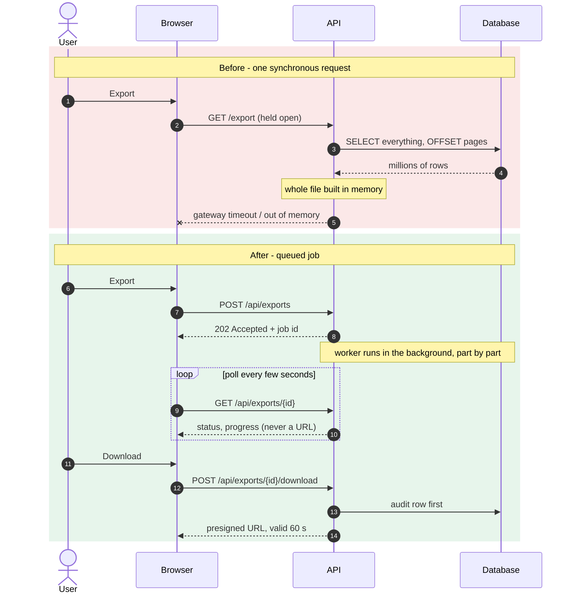
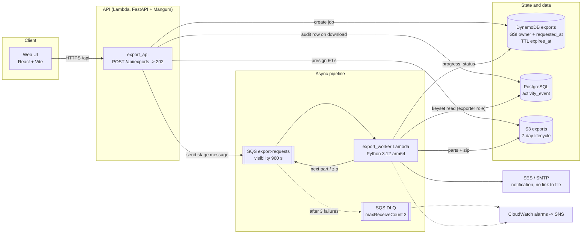
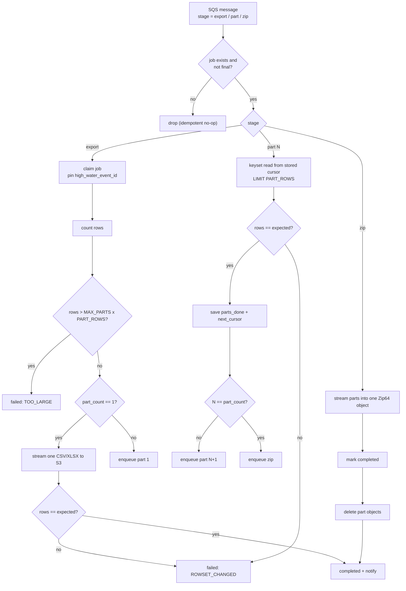
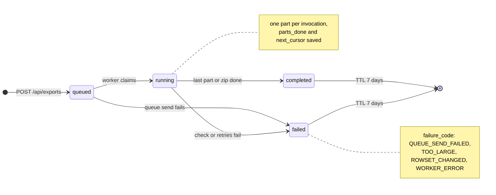
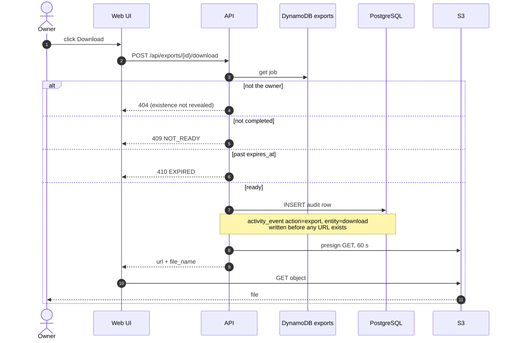

<div align="center">

# Async Export Pipeline

**Exporting millions of rows without timeouts, memory blow-ups or leaked download links.**

A reference implementation of an asynchronous, streaming, audited export pipeline:
FastAPI + SQS + Lambda + DynamoDB + S3, a React UI, AWS CDK, and a one-command local stack.

[](https://github.com/the3ma/async-export-pipeline/actions/workflows/ci.yml)
[](https://github.com/the3ma/async-export-pipeline/actions/workflows/codeql.yml)


[](LICENSE)

[The problem](#the-problem) ·
[What it does](#what-it-does) ·
[Architecture](#architecture) ·
[Quick start](#quick-start) ·
[How it works](#how-it-works) ·
[Deployment](#deployment) ·
[Docs](#documentation)

</div>

---

## The problem

An activity log - one append-only row per user action - had an "Export CSV" button backed by a
single synchronous request. It worked in the demo and failed in production:

- the request held a connection open while the API built the **whole file in memory**, then hit the
  gateway timeout or ran out of memory;
- a hard row limit silently **truncated** large exports, and `OFFSET` paging **skipped or duplicated
  rows** while new events were being written;
- big result sets exceeded the **spreadsheet row limit**;
- the user had no progress, no history and no notification - and anyone holding a download link could
  fetch the file, with **no audit trail** of who downloaded what.

The full write-up, with the ten symptoms and their root causes, is in
[docs/01-the-problem.md](docs/01-the-problem.md).



## What it does

| Capability | How |
|---|---|
| Never blocks the request | `POST /api/exports` stores a job and returns `202 Accepted` in milliseconds |
| Any size, bounded memory | rows are streamed from a server-side cursor straight into S3 multipart uploads |
| Consistent snapshot | keyset pagination on `(occurred_at, event_id)` plus a pinned high-water mark |
| Spreadsheet-safe | results over `PART_ROWS` are split into parts, one worker invocation each, then zipped (Zip64) |
| Survives failures | idempotent stages, at-least-once delivery, 3 retries, dead-letter queue, alarms |
| "My exports" tray | per-owner job list with live progress; the UI polls with back-off |
| Safe notification | the e-mail links to the tray - never the file, never a URL |
| Audited, owner-only download | ownership check, audit row **first**, then a 60-second presigned URL |
| Retention | files expire after 7 days (S3 lifecycle), job records via DynamoDB TTL |
| CSV hygiene | UTF-8 BOM and formula-injection guarding on every cell |

## Architecture



| Component | Path | Stack |
|---|---|---|
| API | [`services/api`](services/api) | FastAPI, psycopg 3, Pydantic; runs on uvicorn locally and on Lambda via Mangum |
| Worker | [`services/worker`](services/worker) | Python 3.12 Lambda (arm64); a poller container runs the same handler locally |
| Shared kernel | [`services/shared`](services/shared) | job model, job store, queue messages, naming, cursors |
| Web UI | [`web`](web) | Vite, React 19, TypeScript strict, MSW mock mode, Vitest, WCAG 2.1 AA |
| Infrastructure | [`infra`](infra) | AWS CDK v2 (TypeScript), cdk-nag, CloudWatch alarms |
| Database | [`db`](db) | PostgreSQL 16 schema (append-only trigger, read-only `exporter` role) and a seed script |
| Local stack | [`docker-compose.yml`](docker-compose.yml) | Postgres, LocalStack (S3/SQS/DynamoDB), Mailpit, nginx |

## Quick start

Requires Docker with Compose v2.

```bash
git clone https://github.com/the3ma/async-export-pipeline.git
cd async-export-pipeline
make up       # build and start everything, waits until healthy
make seed     # 1.2 million activity events
make smoke    # end-to-end: multi-part export -> zip -> audited download -> e-mail
```

| URL | What |
|---|---|
| http://localhost:8080 | Web UI |
| http://localhost:8000/docs | OpenAPI explorer |
| http://localhost:8025 | Mailpit (notification e-mails) |

No Docker? `cd web && npm ci && npm run dev:mock` runs the UI against mocked APIs.
More in [docs/03-running-locally.md](docs/03-running-locally.md).

## How it works

**1. Request.** The API validates the filter, writes a `queued` job to DynamoDB and sends an
`export` message to SQS. If the send fails the job is marked failed and the client gets `503` -
there is never a job that looks queued but will not run.

**2. Plan.** The worker claims the job, pins `high_water_event_id = MAX(event_id)` and counts the
rows. Exports over `MAX_PARTS x PART_ROWS` fail fast with `TOO_LARGE`; small ones are streamed to a
single file.

**3. Parts.** Large exports run as a chain: each invocation writes one part from the stored keyset
cursor, checks the row count, saves `parts_done` + `next_cursor`, and enqueues the next part. A
redelivered or out-of-order message is either a no-op or heals the chain.

**4. Zip.** The last stage streams all parts into one Zip64 object, marks the job `completed`, and
only then deletes the parts - a crash in between never loses data.

**5. Download.** The owner presses Download; the API writes the audit row, then presigns a 60-second
URL. Other users get `404`.

### Worker stages



### Job lifecycle



### Audited download



The design decisions are recorded as ADRs:
[async job](docs/adr/0001-async-job-over-sync-request.md) ·
[keyset + high-water mark](docs/adr/0002-keyset-pagination-and-high-water-mark.md) ·
[one invocation per part](docs/adr/0003-one-invocation-per-part.md) ·
[audit before presign](docs/adr/0004-audit-before-presign.md) ·
[no links in e-mail](docs/adr/0005-no-links-in-email.md).

## Deployment

[`infra`](infra) defines one stack per stage (`dev`, `prod`): S3, SQS + DLQ, DynamoDB, both Lambdas,
an HTTP API, Secrets Manager references, least-privilege IAM, and alarms to SNS. cdk-nag runs on
every synth.

```bash
infra/scripts/build-lambda-artifact.sh worker
infra/scripts/build-lambda-artifact.sh api
cd infra && npm ci
npx cdk deploy -c stage=dev -c workerArtifact=.build/worker.zip -c apiArtifact=.build/api.zip
```

The [deploy workflow](.github/workflows/deploy.yml) does the same on every push to `main` by the
repository owner: it builds the Lambda zips once, publishes the container images to GHCR, and
deploys exactly those artifacts through GitHub OIDC. It skips the deploy step when no
`AWS_DEPLOY_ROLE_ARN` variable is set.

Before using this for real:

- the HTTP API has **no authorizer by default** - pass `-c jwtIssuer=... -c jwtAudience=...` to put
  a JWT authorizer in front of it;
- the activity database is not created by the stack; point it at your RDS / Aurora instance through
  the DB secrets;
- for a private database, `-c useVpc=true -c vpcId=...` runs the Lambdas in your VPC and adds
  interface endpoints (about $70 per month per stage).

## Operations

| Signal | Meaning |
|---|---|
| `DlqNotEmpty` | a job failed three times; it is already marked `WORKER_ERROR` and the owner was told |
| `WorkerErrors` | worker invocations are throwing |
| `WorkerDurationNearTimeout` | parts are getting close to the 15-minute limit - lower `PART_ROWS` |
| `OldestMessageAge` | the queue is backing up - check concurrency and database load |
| `ApiErrors` | the API is returning server errors |

Logs are structured JSON with `export_id` on every line.

## Testing

| Suite | Command | What it covers |
|---|---|---|
| Python | `make test-py` | ruff, mypy strict, pytest (moto for AWS, real PostgreSQL 16 for keyset + roles) |
| Web | `make test-web` | ESLint, Prettier, typecheck, Vitest + Testing Library |
| Infra | `make test-infra` | CDK assertions, cdk-nag, synth |
| End-to-end | `make smoke` | the whole pipeline on the local stack (also runs in CI) |

## Documentation

| Document | |
|---|---|
| [01 - The problem](docs/01-the-problem.md) | the synchronous export, its symptoms and root causes |
| [02 - The solution](docs/02-the-solution.md) | mechanism-by-problem table, end-to-end flow, local vs AWS |
| [03 - Running locally](docs/03-running-locally.md) | stack, URLs, smoke test, troubleshooting |
| [Contract](docs/CONTRACT.md) | endpoints, job fields, queue messages, file naming, environment |
| [ADRs](docs/adr) | the five design decisions |

## License

[MIT](LICENSE)
