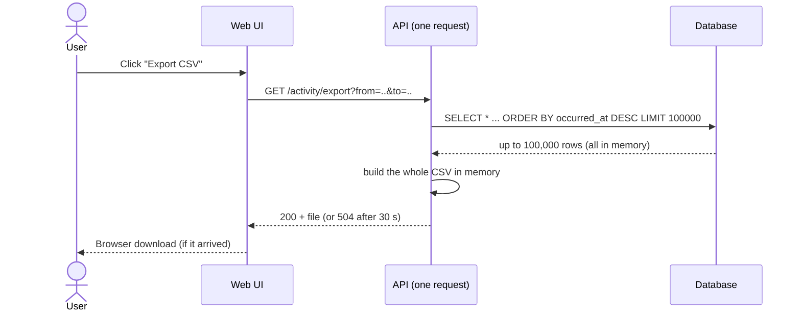

# 1. The problem: "Export" that worked in the demo and failed in production

## Where we started

The product has an **activity log**, an append-only table with one row for every user action (sign-in,
record created, setting changed, file downloaded). Support, security and auditors read it every day, and
they regularly need a copy as a spreadsheet.

The first version of "Export" was the obvious one, and it was a single synchronous HTTP request:

It worked for a week of data. Then the log grew to tens of millions of rows and real users asked for real
date ranges.

## What actually went wrong

| # | Symptom | Root cause | Why it matters |
|---|---|---|---|
| 1 | **Silent truncation.** A 2-million-row range came back as exactly 100,000 rows, with no warning. | A hard `LIMIT 100000` was the only thing keeping memory under control. | The file *looked* complete. An incomplete export of a log is a correctness bug, and an audit finding when it's discovered. |
| 2 | **Timeouts.** Large ranges ended in `504 Gateway Timeout` after 30 s. | The whole query, serialisation and transfer ran inside one request behind a load balancer with a fixed timeout. | Users retried, which made the database load worse. |
| 3 | **Memory spikes / OOM kills.** API pods restarted during exports. | All rows were materialised as objects and the CSV was built as one string. | One user's export took the API down for everyone else. |
| 4 | **Load on the primary database.** Exports slowed down every other screen. | Unbounded `OFFSET`-style scans on the hot table, with no concurrency limit. | A reporting feature degraded the transactional product. |
| 5 | **Inconsistent snapshots.** Two exports of "the same" range had different row counts. | Rows kept arriving while the export paged through `LIMIT/OFFSET`, so pages shifted and rows were duplicated or skipped. | Nobody trusts a number that changes when you ask twice. |
| 6 | **Excel could not open big files.** | One sheet holds at most 1,048,576 rows. | "Just raise the limit" does not work for XLSX. |
| 7 | **No feedback.** Users stared at a spinner and did not know if anything was happening. | No job, no status, no progress. | Duplicate clicks, duplicate work. |
| 8 | **Links in e-mail.** A later "fix" e-mailed a public download link. | Convenience over security. | Anyone holding the e-mail could download the data, and the download was not recorded. |
| 9 | **Files kept forever.** Generated files piled up in a bucket. | No retention policy. | Storage cost, plus copies of sensitive logs with no expiry. |
| 10 | **Nothing recorded who exported what.** | The download happened outside the application's audit path. | For an *activity log*, exporting it is itself an activity that has to be logged. |

## Requirements for the replacement

1. **No row limit.** Any result size is exported completely, or the export fails loudly. It never truncates.
2. Results up to 1,000,000 rows arrive as **one file**. Larger results are split into parts of at most
   1,000,000 data rows (the XLSX limit), which are then **zipped into one download**.
3. **Never block a request** on the export, and never hold a whole file in memory.
4. **Consistent snapshot.** Every row in an export existed when the export started. Rows that arrive later
   don't shift or duplicate pages.
5. **Bounded load** on the database: read through a read-only role, with keyset (seek) pagination and capped
   concurrency.
6. **Status and progress** in the UI (queued → running → completed/failed, with parts done) and a
   **"My exports" tray** for re-downloading until expiry.
7. **Notify when ready**, both in the app and by e-mail, but **never send the file or a download link**.
   The e-mail links to the tray.
8. **Owner-only, short-lived, audited download.** The audit row is written *before* the URL is handed out,
   and the URL expires in seconds.
9. **Predictable file names** that contain no user data, e.g.
   `Activity_Billing_Summary_12-Oct-2026_1430_UTC_01JA2X….csv`, with `_part01-of-03` for parts.
10. **Retention:** files and job records disappear after 7 days.
11. **Operable:** retries, a dead-letter queue, alarms, idempotent stages, and safe re-delivery.

Continue with [2. The solution](02-the-solution.md).
